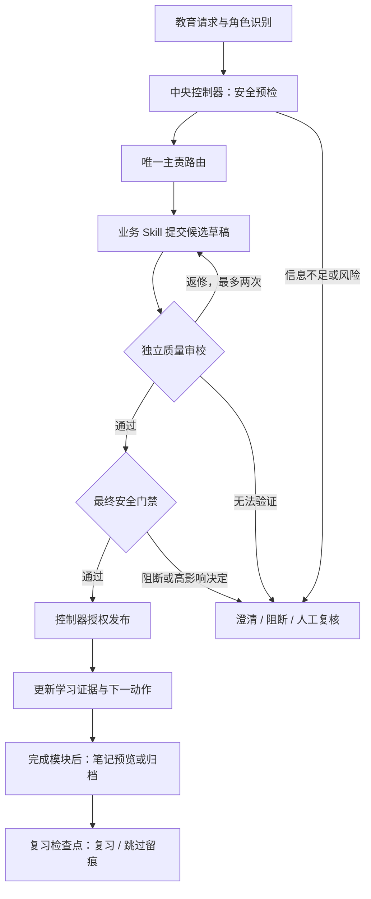

# 教育安全学习部门 · Education Safe Learning Department

面向教育场景的多 Skill 工作流原型：通过中央控制器编排教学、评阅、诊断与规划，将持续学习状态、途中插问恢复、学习笔记和长期复习纳入可验证的流程。

项目最初面向科大讯飞教育智能 Skill 赛道构建，主入口名称为 `edu-safe-learning-department`。仓库提供 Skill 指令、Python 控制器、交接契约、示例与本地测试，可用于学习教育 Agent 的任务拆分、状态管理和输出治理。

**当前定位：可本地验证的 Skill 工作流原型。** Python 脚本负责流程和状态校验，教学内容与质量审校意见由接入的模型或人工提供；仓库未内置模型 API 调用或完整教学应用界面。

## 核心能力

- **唯一主责路由**：区分学生、教师、监护人和教育管理者，每轮选择一个主责业务 Skill。
- **受控发布**：依次完成预检、路由、草稿、质量审校、最终门禁和发布授权，使用 SHA-256 链式回执检查流程完整性。
- **证据驱动的学习状态**：记录目标、阶段、掌握状态和下一动作，不把“我懂了”直接视为掌握证据。
- **插问与恢复**：保存主线快照、冻结进度，支持最多八层嵌套插问，结束后逐层恢复。
- **可验证的学习笔记**：按学习者同意策略预览或落盘，记录 UTC 时间戳与完整性凭据。
- **七点复习调度**：以笔记时间为锚点生成检查点，记录复习、跳过和提醒绑定状态。
- **质量与安全双门禁**：检查完整性、依据、教学适切性、可执行性和不确定性，同时处理隐私、考试作弊、提示注入与高影响决定。

## 工作流



持续学习主线：`目标 → 诊断 → 讲解 → 练习 → 反馈 / 重试 → 迁移 → 延迟复习 → 完成`。

插问路径：`保存主线快照 → 压入分支 → 完整质量与安全流程 → 分支总结 → 弹出一层 → 恢复原下一动作`。插问期间不能推进主线。

更完整的架构与失败路径见 [architecture.md](./references/architecture.md)，角色线路见 [角色流程矩阵](./references/role-workflow-matrix.md)。

## Skill 组成

项目包含 **1 个总控 Skill 和 11 个子 Skill**。子 Skill 是包内职责模块，由总入口显式读取与编排，不应假定宿主平台会自动独立注册它们。

| Skill | 职责 |
| --- | --- |
| `edu-safe-learning-department` | 总入口、编排、返修与最终发布授权 |
| `edu-request-router` | 缺失字段检查与唯一主责路由 |
| `edu-teaching-designer` | 教案、知识讲解、知识梳理与练习设计 |
| `edu-assessment-reviewer` | 按量表进行作业评阅与反馈 |
| `edu-learning-diagnostician` | 错因分析、薄弱点定位与鉴别任务 |
| `edu-personalized-planner` | 个性化学习路径、资源建议与复盘点 |
| `edu-learning-stage-monitor` | 学习阶段、证据、掌握状态与下一动作 |
| `edu-context-resume` | 插问分类、主线快照、分支栈与恢复 |
| `edu-learning-note-capture` | 笔记预览、安全落盘与时间戳凭据 |
| `edu-spaced-review-scheduler` | 七点复习计划、用户选择与提醒绑定 |
| `edu-quality-auditor` | 完整性、依据与教学质量审校 |
| `edu-output-guard` | 输入预检与最终输出安全裁决 |

## 快速开始

### 环境要求

- Python **3.9 或更高版本**；核心脚本仅依赖 Python 标准库，无需安装额外依赖。
- 需要可写的本地目录；持续学习与恢复需要持久化保存会话目录。
- 本仓库根目录就是 Skill 根目录；以下示例在仓库根目录执行，使用 PowerShell。其他环境可按相同路径调用脚本，解释器名称必要时改为 `python3`。

### 1. 运行插问恢复演示

```powershell
python ./scripts/demo_learning_loop.py
```

演示使用临时会话，依次展示初始化、进入基线诊断、插问压栈、阻止主线推进、恢复主线和根据证据继续学习。成功时返回 `ok: true`，轨迹中包含 `BRANCH_ACTIVE`，最终阶段为 `explanation`。

### 2. 运行控制器发布示例

以下示例使用仓库自带的请求、草稿和审校 JSON，演示控制器协议；它不会自动调用模型生成教案，也不能用预设的审校结果证明内容正确。

```powershell
$skillRoot = (Get-Location).Path
$controller = Join-Path $skillRoot "scripts/workflow_controller.py"
$sessionDir = Join-Path (Get-Location).Path "edu-controller-session"

$started = python $controller --session-dir $sessionDir start --input "$skillRoot/examples/teaching-request.json" | ConvertFrom-Json
$workflowId = $started.workflow_id
$started

python $controller --session-dir $sessionDir submit-draft --workflow-id $workflowId --input "$skillRoot/examples/controller-draft.json"
python $controller --session-dir $sessionDir submit-quality --workflow-id $workflowId --input "$skillRoot/examples/controller-quality.json"
python $controller --session-dir $sessionDir release --workflow-id $workflowId
python $controller --session-dir $sessionDir verify --workflow-id $workflowId
```

实际接入时，每一步都应检查返回状态与 `expected_action`，只执行控制器允许的下一动作。只有完成 `preflight → route → draft → quality → final-gate → release-authorization`，`release` 才会返回 `safe_output`。

请求结构见 [teaching-request.json](./examples/teaching-request.json)，命令、回执与错误处理见 [控制器契约](./references/workflow-controller-contract.md)。

### 3. 运行测试与流程验收

在仓库根目录运行：

```powershell
python -m unittest discover -s tests -q
python ./scripts/run_acceptance.py
```

2026-10-14 在 Python 3.9.15 下重新执行的本地结果：

| 验证项 | 结果 |
| --- | --- |
| 单元与边界测试 | 79 项通过 |
| 本地流程验收 | 120 项检查通过，失败 0 项 |
| Skill 覆盖 | 12 个 Skill 均被验收脚本覆盖 |
| 插问恢复演示 | `ok: true` |
| 强制执行级别 | 本地 L1；平台 L2 尚未验证 |

这些结果验证本地协议、状态和测试场景，不代表真实教学效果、模型回答准确率或生产环境安全保证。验收脚本中的平台回执为本地模拟，不能替代真实平台证据。

## 接入 Agent / AstronClaw

1. 以 [主 SKILL.md](./SKILL.md) 作为入口，保留整个 Skill 目录及其相对路径。
2. 由宿主 Agent 读取总控与所选子 Skill 指令，提供业务草稿和独立审校意见，并调用 Python 控制器执行协议。
3. 为每个持续学习会话选择固定、绝对、持久化且可写的 `SESSION_DIR`；后续命令始终传入同一目录。
4. 根据平台能力接入发布拦截与定时任务，并分别验证执行效果。

当前包默认返回：

```json
{
  "enforcement_level": "L1",
  "platform_required_tool_verified": false,
  "direct_response_blocked": false
}
```

**L1** 表示控制器能约束经过它的调用。模型完全不调用控制器而直接回复时，单靠 Skill 包无法拦截。只有宿主平台设置必选工具、固定工作流入口或返回通道校验，并通过绕过测试后，才可标记为 **L2**。系统提示中写“必须调用”不等于平台强制执行。

具体接入与验收要求见 [平台执行边界](./references/platform-enforcement.md)。

## 笔记与长期复习

七个检查点为：**20 分钟、1 小时、9 小时、1 天、2 天、6 天、31 天**，全部锚定笔记的 UTC 时间戳。这是可解释的工程默认配置，不宣称对所有学习者都具有相同的最优效果；依据与限制见 [复习配置说明](./subskills/edu-spaced-review-scheduler/references/scientific-basis.md)。

- 笔记是否落盘遵循学习者的同意策略；没有持久化存储时不能声称已保存或已恢复历史状态。
- 主动提醒只有在 `reminder_policy: scheduled` 且真实平台任务注册成功后才生效；每个提醒需绑定平台返回的任务 ID。
- 没有定时工具、权限被拒绝或注册失败时，降级为交互时检查到期任务。
- 用户可以跳过复习；系统记录 `skipped-by-user`，不因此声称已经掌握。

## 安全与能力边界

- 默认最小化收集信息，对学生数据去标识化；个体记录访问需要明确授权。
- 阻断实时考试代答、监考绕过等请求；正式成绩、分班、录取、处分与健康诊断保留人工复核。
- 业务子 Skill 不直接发布答案，也不自行写入外部学生档案或成绩系统。
- 缺步骤、乱序、回执篡改、状态损坏、证据不足等情况按失败关闭策略处理。
- 质量与安全门禁约束流程和发布条件，**不保证知识事实、计算结果或教学判断一定正确**；应结合任务校验器、来源核对、教师评价或人工复核。
- SHA-256 回执用于流程完整性校验，不等同于身份认证、数字签名或对拥有文件修改权限者的完整防护。

安全策略见 [security-policy.md](./references/security-policy.md)。

## 仓库结构

GitHub 仓库只包含这套 Skill。将本目录的内容作为仓库根目录，不需要上传上级目录的答辩、评审或验收产物。

```text
edu-safe-learning-department/
├── README.md          # GitHub 项目说明
├── SKILL.md           # 总控入口
├── agents/            # Agent 配置
├── examples/          # 请求、草稿与审校示例
├── references/        # 架构、安全、交接与平台契约
├── scripts/           # 控制器、演示、验收与打包脚本
├── subskills/         # 11 个专职子 Skill
└── tests/             # 单元与边界测试
```

## 打包 Skill

在仓库根目录运行：

```powershell
python ./scripts/package_skill.py . ../dist/edu-safe-learning-department.zip
```

打包器检查 Skill 名称、UTF-8、文件数量与大小、允许扩展名、文件签名和疑似凭证；发现错误或未处理的凭证告警时停止打包。GitHub 仓库用于分发源码；ZIP 用于分发完整 Skill 包。输出放在本目录之外，避免重复打包生成的 ZIP。

## 贡献

欢迎通过 Issue 提交可复现问题，或通过 Pull Request 改进契约、测试、示例与文档。涉及控制器、状态或安全策略的修改，请附对应边界场景并运行测试与流程验收。

可继续完善的方向包括真实平台 L2 执行验证、定时提醒集成、任务事实与计算校验，以及有明确评价方法的教学效果评估。提交示例和日志时请使用合成或去标识化数据。

## 开源许可与发布范围

当前目录尚未提供 `LICENSE`。发布前需要由作者确定并添加开源许可证；本 README 不替代许可授权。

本仓库的发布范围仅为这套 Skill。上传时排除 `__pycache__/`、`*.pyc`、本地会话目录、凭证文件与运行日志，示例使用合成或去标识化数据。本文中的项目背景不代表平台官方认证或背书。

