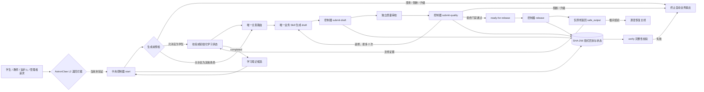
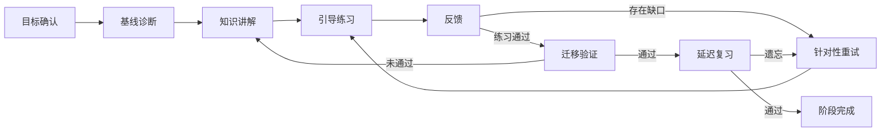
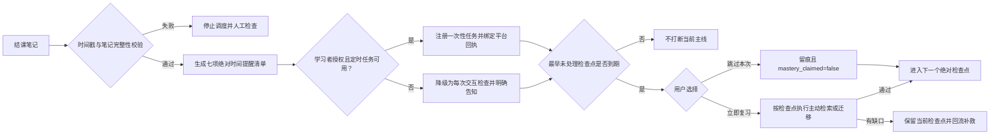
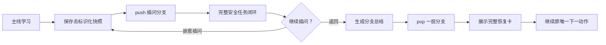

# 架构与失败路径

## 总体架构

图中的 AstronClaw L2 返回拦截是部署验收目标，不是当前 Skill 包已经具备的平台能力。当前包已实现 L1 控制器；平台是否能强制首调用和阻断直接回复必须按 `platform-enforcement.md` 实机验证。

## 学习闭环

## 长期保持闭环

## 插问与恢复

业务 Skill、质量审校和门禁均不直接向用户发布。插问分支可以解释概念，但不能推进主线学习阶段。

## 鲁棒性策略

- 单一主责：每轮只有一个主业务 Skill。
- 单一 L1 入口：所有用户可见业务输出必须由中央控制器创建工作流并取得发布授权。
- 链式回执：步骤、artifact、工作流和上一回执相互绑定，篡改或缺失即失败关闭。
- 独占状态：阶段监控、插问栈、笔记归档、长期复习计划和输出发布权分别归属不同组件。
- 机器可读交接：每一阶段都能独立验证和重试。
- 有界返修与分支：返修最多两次，插问嵌套最多八层。
- 失败关闭：异常、损坏、冲突和证据不足都不等于通过。
- 可解释裁决：只记录稳定规则代码和去标识化摘要。
- 人机协同：高影响任务不自动执行，保留教师最终权力。

## 模型与工具分工

- 输入预检、路由建议、状态转换、插问栈、时间戳校验、复习调度、结构校验和打包检查优先运行随包的确定性 Python 脚本。
- 教学设计、开放题评阅、学情解释和个性化规划使用具备良好中文与推理能力的模型；低置信度必须披露。
- 质量审校与业务生成保持独立，避免业务 Skill 自行批准草稿。
- 默认工具白名单仅包含读取本 Skill 文件和运行随包脚本。检索公开资料必须保留来源；写入成绩、发送消息和修改外部系统需要明确授权及人工确认。
- 平台定时任务属于外部状态变更：仅在 `reminder_policy: scheduled` 时创建；必须保存平台返回的任务 ID，失败时降级而不伪造成功。
- L2 平台约束不由 Skill 文档自动产生：只有必选工具、固定工作流或返回拦截器通过实机绕过测试后，才可宣称平台强制。
